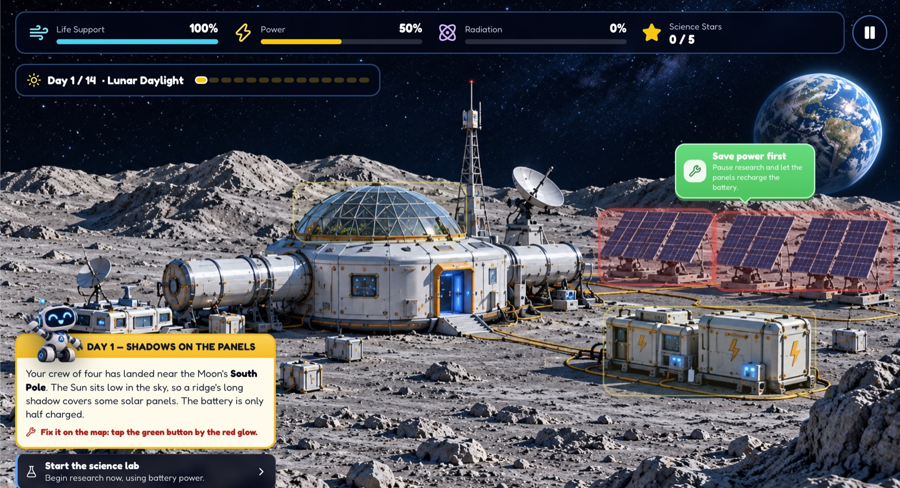
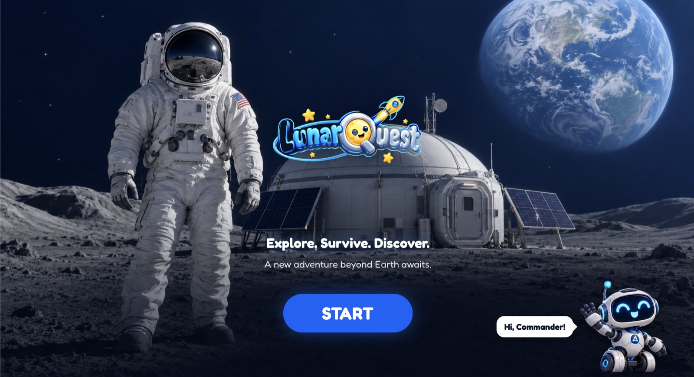
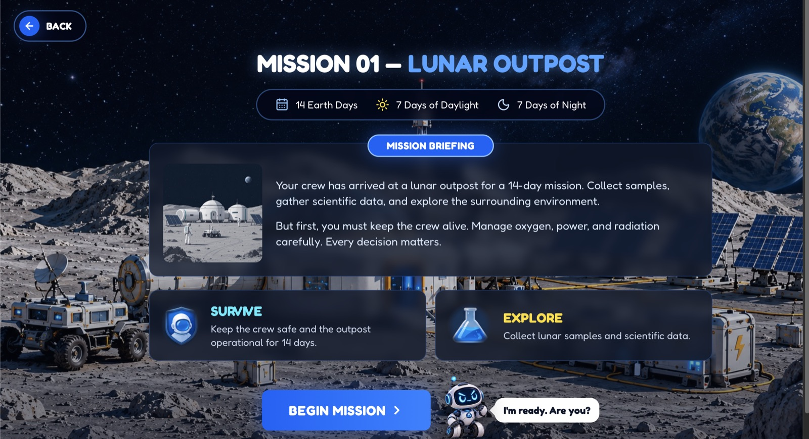
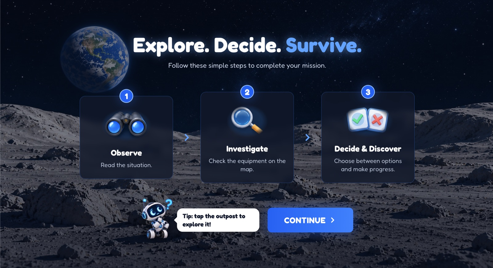
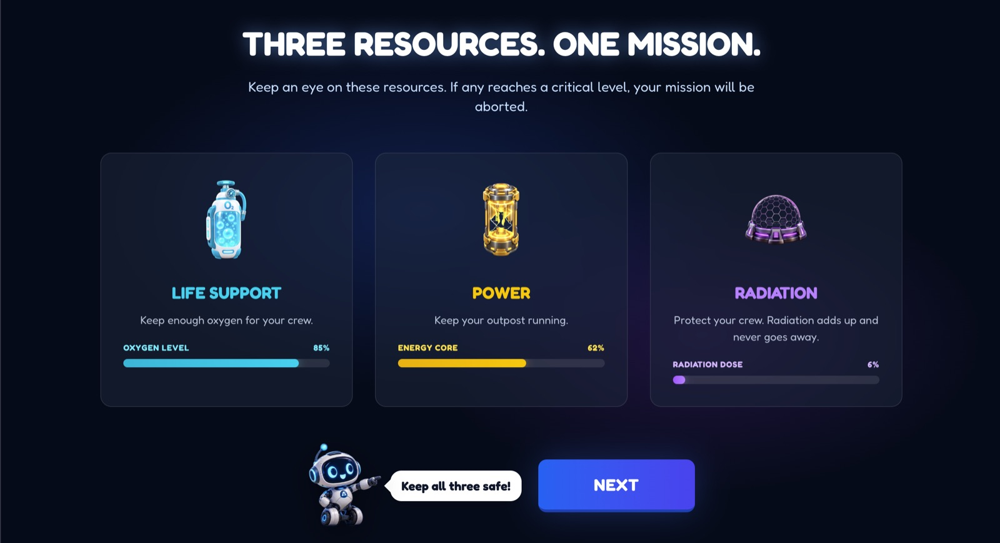
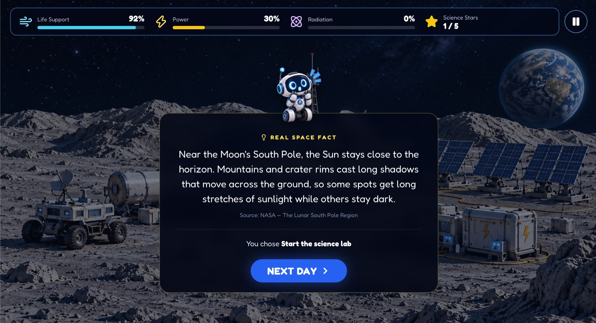
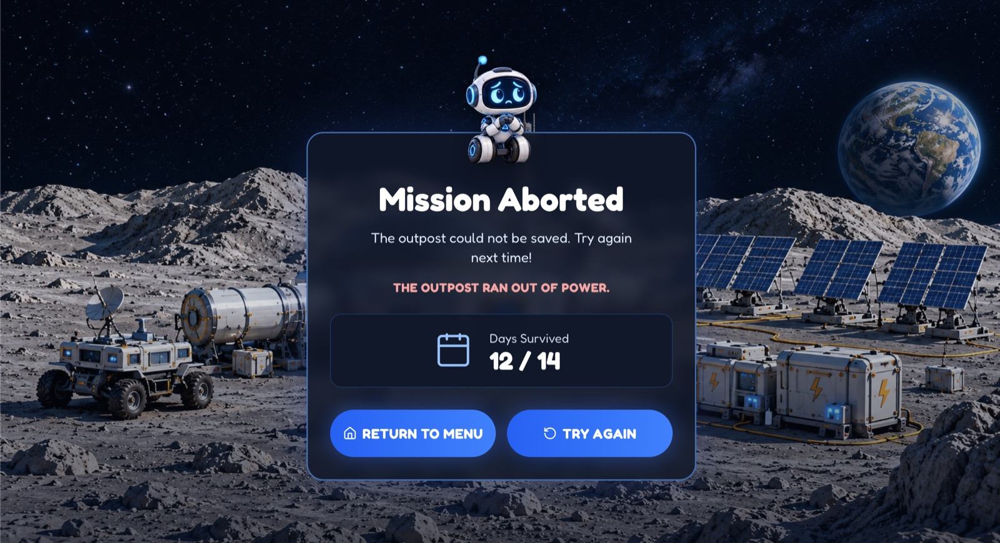
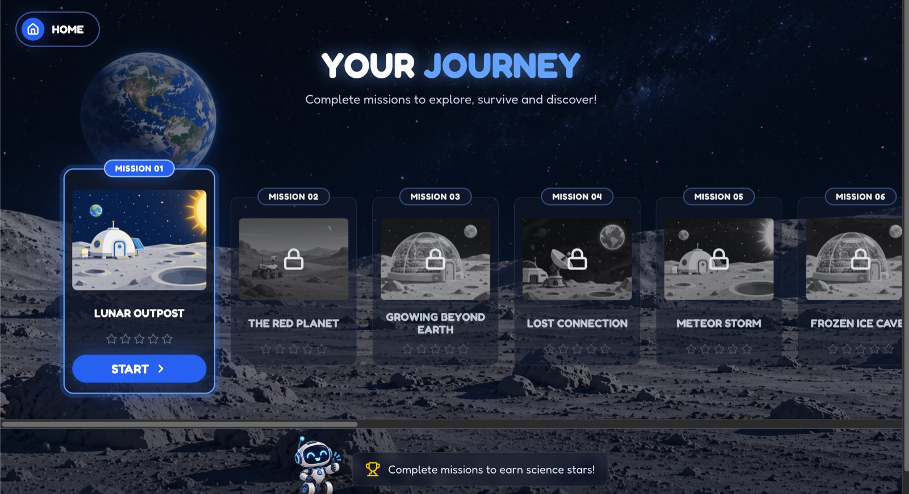

<div align="center">


# LunarQuest

**A Junior Astronaut Mission Trainer where every choice has a price.**

Command a lunar outpost for 14 days, keep your crew alive, and learn real NASA science along the way.

</div>

> [!TIP]
> **Page not loading?** 🌙 Some internet providers block `vercel.app` links from time to time, especially on mobile data. No worries, the same game is waiting for you on our **[backup link](https://lift-dev.github.io/LunarQuest/)**. Turning on a **VPN** also usually fixes the main link right away.
>
> **Sayfa açılmıyor mu?** 🌙 Bazı internet sağlayıcıları `vercel.app` bağlantılarını zaman zaman engelleyebiliyor, özellikle mobil veride. Merak etme, aynı oyun **[yedek bağlantımızda](https://lift-dev.github.io/LunarQuest/)** seni bekliyor. Bir **VPN** açmak da ana bağlantıyı genellikle hemen düzeltir.

<div align="center">

### [▶ Play it now: lunarquest.vercel.app](https://lunarquest.vercel.app)

Not opening? Try the backup: **[lift-dev.github.io/LunarQuest](https://lift-dev.github.io/LunarQuest/)**

No download. No account. Works on a phone, tablet or laptop.

*Built by **Team Milky Way** for the 2026 NASA Space Apps Challenge: "Build a Junior Astronaut Mission Trainer" (ages 7–12).*



</div>

---

## In 30 seconds

Kids usually meet space as something to watch. In LunarQuest they **make the decisions** a real crew would face, and see what each one costs.

- You are the Mission Commander of a four-person crew at a lunar outpost.
- You have **14 Earth days** and **three resources** to protect: Life Support, Power and Radiation.
- Every day brings a situation and **two options. Neither one is free.**
- After each choice, a **Real Space Fact** explains the science and names its NASA source.
- Choose well and you earn up to **5 Science Stars**. Choose badly and the mission is aborted.

## Why LunarQuest

| What we set out to do | How it shows up in the game |
|---|---|
| **Real trade-offs, not quiz questions** | All 7 decisions in Mission 01 gain something and give something up. Running the science lab costs power. Finishing samples in a solar storm costs radiation. |
| **Real NASA data, not invented numbers** | Oxygen use, radiation limits and the solar storm all come from NASA sources. 15 pages were opened and read, and each fact cites its source. |
| **Consequences that carry forward** | Skip cleaning the panels on Day 3 and your power drains every day after. Mistakes compound, as they do on real missions. |
| **Replayable** | The Day 7 solar storm is one of 7 archived NASA flares, picked at random. Three carry fast particles that get through spacesuits, so the same choice can be safe in one run and fatal in the next. |
| **Made for 7–12 year olds** | Plain words, one idea per screen, a robot guide that reacts to every choice, and a phone-first layout that plays like a movie in landscape. |
| **Zero friction** | Runs in the browser. No account, no install, no server. |

## How it plays

**One day, four steps:** observe the situation, investigate equipment on the outpost map, decide between two options, then learn the Real Space Fact.

### The three resources

| Resource | The real rule behind it | The mission is aborted when |
|---|---|---|
| **Life Support** | Each astronaut breathes 0.85 kg of oxygen a day (ISS data) | The oxygen reserve runs out |
| **Power** | Solar panels charge the battery; moon dust halves their output | Power falls below 10% |
| **Radiation** | The dose adds up and never goes away | It reaches 250 mSv, NASA's limit for a solar storm |

### Mission 01: seven decisions

| Situation | Option A | Option B |
|---|---|---|
| Shadows on the Panels | Start the science lab | Save power first |
| Dust on the Panels | Clean the panels by hand | Leave the dust |
| Damaged Power Cable | Repair the cable | Switch to the backup cable |
| Solar Storm Warning! | Go to the storm shelter | Finish collecting samples |
| Oxygen from Moon Soil | Run the oxygen machine | Keep it switched off |
| Carbon Dioxide Alert | Use a spare filter canister | Bake the filters clean |
| Final Countdown | One last experiment | Pack up for the trip home |

## See it in action

| | |
|---|---|
|  |  |
| **Welcome.** One tap to start, with no sign-up. | **Briefing.** You are the Mission Commander. |
|  |  |
| **How to play.** Observe, investigate, decide. | **Learn to survive.** Three resources to protect. |
|  |  |
| **Real Space Fact.** The science behind every choice, with its NASA source. | **Mission aborted.** The game explains what went wrong, so the next run goes better. |

<p align="center"><br/><b>The journey.</b> Mission 01 is playable now, and the rest are already laid out.</p>

## Real NASA data

Everything a player reads is traceable to NASA.

- **Solar storms from the archive.** The Day 7 storm replays a real flare from [NASA DONKI](https://ccmc.gsfc.nasa.gov/tools/DONKI/), such as the X8.2 flare of 10 September 2017. It is always labelled *"Archived NASA data"*, never presented as live.
- **Real limits.** The radiation abort level is the 250 mSv solar-particle-event limit from NASA-STD-3001.
- **Real numbers.** 0.85 kg of oxygen per astronaut per day (ISS), and about 0.5 mSv per day of radiation on the lunar surface.
- **Real facts.** Every decision ends with a fact from NASA (Apollo, Artemis, LRO, ISS, Kennedy Space Center and more).

📚 **[Full list of sources and what each one supports](docs/SOURCES.md)**

We are open about what is *not* from NASA: a few balance numbers, such as battery size and the oxygen reserve at which a mission aborts, are game design choices. They are marked as assumptions in the code and listed in the sources document.

## Is it fair and balanced?

A game about trade-offs only works if the trade-offs are real, so we tested every path. The balance check simulates **all 128 choice paths** against each type of storm, and the same walk runs as an automated test.

| Play style | Result |
|---|---|
| Lazy start (lab first, leave the dust, backup cable) | Power runs out by Day 8 |
| Science-greedy (every star option) | Radiation abort in the worst storms |
| Spacewalk-heavy (never shelter, skip the oxygen machine) | Air or radiation runs out |
| **Balanced** (save power, fix things, shelter, run the machine) | **Survives with 3 stars in every storm** |
| Stay inside (never go out except to shelter) | Survives with 1 star |

Full tables: [docs/SCENARIOS_MISSION_01.md](docs/SCENARIOS_MISSION_01.md) §7.

## Built to be reliable

- **A game engine with no UI code.** The rules are pure TypeScript in [`src/game/`](src/game), so they can be tested without a screen.
- **43 automated tests** cover the engine, scoring, the map inspection logic and the mission data.
- **Content is data.** A new mission is a new JSON file, validated by a [Zod](https://zod.dev) schema at load time. A test also checks that every player-facing sentence matches the documented, sourced script word for word.
- **Fast on a phone.** The first load is about 135 kB gzipped. Each screen loads when it is first visited.
- **Responsive.** Layouts for portrait phones, landscape phones (full screen and locked sideways on Android) and desktop.
- **Accessible.** Keyboard-operable map, labelled controls and meters, and reduced-motion support.

## Run it locally

```bash
npm install
npm run dev        # http://localhost:5173
npm test           # engine, scoring and data tests
npm run build      # typecheck + production build
npm run preview    # serve the production build
```

**Stack:** Vite · React · TypeScript · Tailwind CSS v4 · Zustand · Zod · React Router · Motion · Vitest. Deployed as a static site on Vercel (`vercel.json` handles routing and caching), with a backup copy on GitHub Pages that a workflow rebuilds on every push to `main`.

## Project layout

```
src/
  game/          Pure TypeScript engine, schemas and scoring (no React)
  data/          Mission 01 content, balance numbers, levels, solar flares, sources
  screens/       One file per screen
  features/      HUD, outpost map, scenario cards, mascot, notices, pause menu
  design-system/ Buttons, panels, modal, mascot, backgrounds
  store/         Game state (Zustand)
  lib/           Full screen and orientation helpers for phones
docs/            Scenario script, sources, project plan, session transcripts
image-assets/    UI design references
public/assets/   Images used by the game
```

## Documentation

| Document | What is in it |
|---|---|
| [docs/SOURCES.md](docs/SOURCES.md) | Every NASA source, and what each one is used for |
| [docs/SCENARIOS_MISSION_01.md](docs/SCENARIOS_MISSION_01.md) | The full Mission 01 script: units, daily rules, all 7 scenarios, the exact quote behind each fact, and the balance check |
| [docs/PROJECT_PLAN.md](docs/PROJECT_PLAN.md) | The early project plan and architecture (some details have since changed) |
| [docs/ASSET_REQUESTS.md](docs/ASSET_REQUESTS.md) | The UI artwork brief |
| [docs/session-transcripts/](docs/session-transcripts) | Working sessions that shaped the project |

## Status and roadmap

| | |
|---|---|
| ✅ **Done** | Mission 01 playable from start to finish · interactive outpost map with equipment inspection · seven decisions with NASA facts · real solar-storm replay · scoring and Science Stars · mission complete and aborted screens · responsive phone and desktop layouts · deployed on Vercel, with a GitHub Pages backup |
| 🔜 **Next** | Save and resume progress · balance testing with real 7–12 year olds · an in-app Science Sources screen |
| 🌙 **Later** | Missions 02–15 (already laid out on the Journey screen) · new scenarios built on more NASA data |

## Team

**Milky Way**, NASA Space Apps Challenge 2026.

## Credits

Space data courtesy of NASA. LunarQuest is an independent educational project and is not affiliated with or endorsed by NASA.
